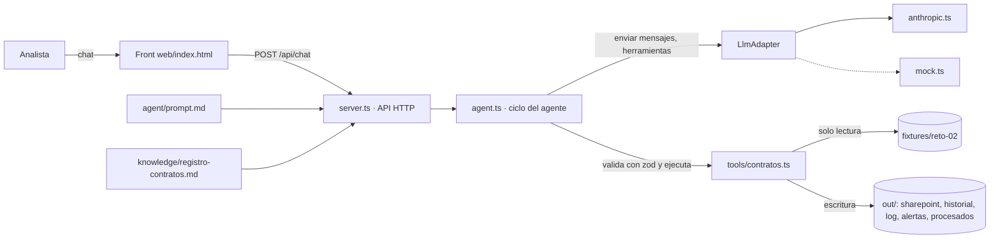

# SOLUCIÓN · Reto 02 — Agente "Registro de Contratos Vigentes"

## 1. El problema en una frase
Periferia no sabe qué contratos tiene vigentes, cuáles vencen ni qué pólizas están en riesgo. El maestro está congelado desde el 30 de mayo de 2026 y solo llegan los contratos que requieren póliza.

**A quién le duele:**
- A la **analista administrativa**, que no tiene de dónde alimentar el maestro.
- A la **gerencia**, que no puede responder "¿qué vence este trimestre?".
- A la **compañía**, que asume riesgo contractual por pólizas exigidas que nadie gestiona.

**Por qué se rompió:** el proceso dependía de una sola persona.

## 2. Arquitectura

| Capa | Dónde vive | Qué contiene |
|---|---|---|
| **Comportamiento** | `agent/prompt.md` | Cómo actúa el agente: flujo, reglas que no puede romper y formato de respuesta |
| **Conocimiento** | `src/knowledge/registro-contratos.md` | Reglas RN1–RN7, parámetros, casos especiales y lectura de alertas |
| **Ejecución** | `src/tools/contratos.ts` | Extracción, validación, registro, archivo y alertas. Es la **única** fuente de valores |
| Ciclo | `src/agent.ts` | Bucle con tope de iteraciones, validación zod, confirmación humana y tope de tokens |
| Proveedor | `src/llm/adapter.ts` + `anthropic.ts` | Interfaz `enviar(peticion)`. Cambiar de proveedor no toca el ciclo |
| Transporte | `src/server.ts` | API REST, sesiones (en memoria y en archivo), clave de acceso y límite de peticiones |

El servidor arma el system prompt así: `prompt.md` + `registro-contratos.md` + la fecha del sistema. Por eso, **cambiar una regla de negocio no toca el servidor.**

## 3. Ciclo del agente
1. El usuario escribe y empieza un nuevo turno (`turno++`).
2. Se envía al modelo: el system prompt, el historial y las 5 herramientas. El esquema JSON de cada herramienta se genera desde zod con `z.toJSONSchema`.
3. Si el modelo pide herramientas:
   - Cada argumento se **valida con zod** antes de ejecutar. Si no cumple, el error vuelve al modelo como `tool_result` y no se ejecuta nada.
   - Cada llamada queda en el historial de la sesión (que el front muestra) y en `out/log.jsonl` (CA4).
4. El bucle se repite hasta que el modelo responde sin pedir herramientas, o hasta llegar al **tope de 25 iteraciones (CA1)**. En ese caso el agente responde con lo que tiene y pide "continúa".
5. **Topes de costo:** hay límite de tokens por sesión, límite de peticiones por IP y por minuto, y un mutex por sesión que evita turnos concurrentes.
6. **Errores (CA5):** un timeout o un error del proveedor se muestra en lenguaje claro y la sesión sigue viva. Las herramientas nunca lanzan excepciones: siempre devuelven `{ ok:false, error }`.

### Confirmación humana (CA3): la exige el servidor, no solo el prompt
- Cuando `contratos_validar` devuelve `requiere_revision` con campos, o `contratos_registrar` responde "requiere revisión", el servidor marca ese mensaje como **pendiente** y anota el turno.
- Si el modelo intenta `confirmado: true` **en el mismo turno** en que se detectó la revisión, el servidor **bloquea** la llamada. Le devuelve un error que le pide terminar el turno con una pregunta.
- La confirmación solo se acepta en un turno posterior, es decir, después de que el usuario escribió.
- `needsConfirmation = true` mientras haya pendientes. Con eso el front resalta el mensaje en amarillo.
- Está cubierto por pruebas en `tests/agente.test.ts`.

### Valores que el modelo no puede inventar (CA2)
- `contratos_validar` y `contratos_registrar` **vuelven a extraer el documento** desde `mensaje_id`. No confían en lo que envía el modelo.
- Si un valor enviado difiere del extraído, su confianza pasa a 0 y exige confirmación. Así, un "redondeo" del modelo nunca llega al maestro sin que un humano lo apruebe.
- El modelo nunca recibe el texto crudo del contrato, solo campos estructurados. Esto también reduce la superficie de *prompt injection* desde los documentos.

## 4. Elección del modelo y costo
**Proveedor y modelo:** Anthropic, `claude-sonnet-4-5`, configurable con `ANTHROPIC_MODEL`.

**Por qué:**
- El trabajo del modelo es orquestar herramientas y redactar en español. Para eso se necesita un uso confiable de herramientas en paralelo y buen cumplimiento de instrucciones del tipo "no registres sin confirmar".
- La extracción es determinista, así que el modelo **no** lee contratos. Por eso un modelo intermedio es suficiente.
- Se usa `temperature: 0` y *prompt caching* del system prompt, que se reenvía en cada iteración.

**Estimación para el lote de la demo** (6 mensajes, unas 18 llamadas a herramientas y unas 18 iteraciones):

| Concepto | Tokens aprox. |
|---|---|
| System prompt + herramientas (cacheado tras la 1.ª iteración) | 3.500 × 18 |
| Historial creciente sin caché (promedio) | 3.500 × 18 ≈ 63.000 |
| Salida (razonamiento breve + respuesta final) | ≈ 3.500 |

Con precios de lista de Sonnet (USD 3 por millón de tokens de entrada, 15 por millón de salida y caché a 0,1×; **verificar precios vigentes**), el lote cuesta cerca de **USD 0,25–0,30**, es decir, **unos USD 0,05 por contrato procesado**.

Con un modelo más pequeño (familia Haiku), el costo bajaría a un tercio aproximadamente, a cambio de un seguimiento de instrucciones un poco menos robusto. Es viable precisamente porque la extracción no depende del modelo.

## 5. Estrategia de extracción
Toda la extracción es determinista: expresiones regulares y heurísticas sobre el texto del documento.

| Campo | Cómo se obtiene | Confianza |
|---|---|---|
| Tipo de documento | Primera línea: `OTROSÍ`, `CONTRATO MARCO`, `CONTRATO` o `COTIZACIÓN` | Clasifica el caso; si no es contrato, se rechaza |
| `id_contrato` | `No. XX-AAAA-NNN` en el encabezado. En un otrosí, el número del contrato base | 0.95. Si falta, se asigna `AUTO-` al registrar |
| Partes | Segmento entre "Entre" y "y PERIFERIA IT GROUP". El nombre en mayúsculas se busca en el bloque de firmas para conservar su forma real (ej. "Corporación Andina **de** Servicios") | 0.95 si se encuentra en las firmas; 0.85 si se arma por capitalización |
| `nit_cliente` | NIT, RUC o RTN. Al NIT se le quitan el dígito de verificación y los puntos | 0.95 |
| `pais` | Tipo y longitud del identificador (NIT→CO, RUC de 13 dígitos→EC, RUC de 11→PE, RTN→HN) cruzado con la ciudad de domicilio | 0.95 si ambas fuentes coinciden; 0.85 si hay una sola; 0.5 si se contradicen |
| `valor` y `moneda` | Línea `VALOR`: código ISO + número. Se identifica el separador decimal (`265.000.000` frente a `120,000.00`) y se valida contra el valor en letras (PESOS, DÓLARES, SOLES) | 0.95 si coincide con las letras; 0.85 si no |
| Valor por demanda | "no tiene valor determinado" u "órdenes de servicio": valor 0 y `valor_indeterminado` | 0.5, así que va a revisión |
| Plazo | Línea `PLAZO`: fechas en formato "(d) de mes de aaaa" y "(N) meses". Se verifica que las fechas cuadren con el número de meses | 0.95 si son coherentes |
| Plazo derivado | Sin fechas: inicio = fecha de firma y fin = inicio + N meses − 1 día | Inicio 0.8 si solo se conoce el mes; fin 0.5 si hay prórroga automática o el día es incierto |
| Póliza | Cláusula de garantías: tipos detectados (cumplimiento, calidad, salarios, responsabilidad civil, etc.) | 0.95. Póliza condicional: 0.8. Sin cláusula: `false` con 0.85 |
| Otrosí | Solo cambian los campos presentes en el documento. Si exige "ampliar" las garantías, `estado_poliza` pasa a `pendiente` | — |

**Dónde no entra el modelo:** no extrae, no calcula fechas ni clasifica.

**Dónde sí entra:** orquesta el flujo, explica los resultados a la analista, interpreta su confirmación o corrección y redacta el resumen.

Si se quisiera enriquecer la extracción con el modelo, cualquier valor que proponga pasa por `contratos_validar`: queda con confianza 0 y requiere confirmación humana.

## 6. Propuesta de regla de gobierno (una página)

> **Política: "Sin registro no hay factura"**
> **Dueño del maestro:** la Dirección Administrativa y Financiera responde por él. La analista administrativa lo opera y tiene un **suplente designado**, para que el proceso no dependa de una sola persona.

**1. Canal único**
- Todo documento contractual se envía a **contratos@periferia-ficticia.com**.
- Ese buzón compartido lo administra la analista administrativa, con el suplente como respaldo.
- El agente lo procesa al menos dos veces al día.
- Los contratos enviados a personas, por chat o por otros medios **no se consideran recibidos**.

**2. Obligación del comercial**
- **Qué debe enviar:**
  - El contrato firmado en PDF, **con o sin póliza**.
  - Otrosíes.
  - Actas de inicio, terminación y liquidación.
  - Órdenes de servicio de los contratos marco.
- **Plazo:** a más tardar **3 días hábiles después de la firma**.
- **Formato:** un documento por correo, con este asunto:
  `[CONTRATO|OTROSI|ACTA|OS] <número de contrato> - <cliente>`
  Ejemplo: `[OTROSI] CT-2026-011 - Minera Los Andes`

**3. Acuse automático**
- En menos de **1 hora hábil**, el agente responde al remitente con:
  - La clasificación (nuevo, actualización, duplicado o rechazado).
  - El número de contrato asignado.
  - La ruta donde quedó archivado.
  - Los campos que quedaron en revisión.
- Si el documento se rechaza, el acuse explica **el motivo y qué falta**.

**4. Excepciones y escalamiento**

| Caso | Tratamiento | Escalamiento |
|---|---|---|
| Contrato sin firmar | Se rechaza y se devuelve al comercial | Si en 2 días hábiles no llega firmado → jefe comercial |
| Sin valor (contrato marco o por demanda) | Se registra con valor 0 tras la confirmación de la analista. Cada orden de servicio se envía como `[OS]` | — |
| Sin número de contrato | Se asigna `AUTO-<año>-<n>` y se notifica al comercial | — |
| Remitente no registrado | Se registra y se pide al jefe comercial que confirme quién es el responsable | Jefe comercial |
| Póliza `pendiente` por más de 10 días hábiles | Alerta a la gerencia y al corredor | Gerencia |
| Datos que la analista no puede confirmar | Quedan en revisión; se consulta al comercial | 3 días hábiles → jefe comercial |

**Consecuencia por incumplimiento:** el área de facturación **no emite facturas** de un contrato que no esté en el maestro. Es el incentivo que hace que el proceso se mantenga sin perseguir a nadie.

**5. Cierre del gap (junio–agosto de 2026): una sola campaña de 2 semanas**
1. **Día 1:** Facturación entrega la lista de clientes y órdenes de compra facturados entre el 1 de junio y el 31 de agosto. Se cruza con el maestro por NIT para obtener los **faltantes por comercial**.
2. **Días 2 a 8:** cada comercial reenvía sus contratos al buzón con el prefijo `[GAP]`. El agente los procesa en lote y la analista confirma los campos dudosos.
3. **Día 10:** reporte de cobertura del gap para la gerencia, con los pendientes nominales por comercial.
4. **Día 14:** cierre. Lo que siga faltando se escala a la gerencia comercial y entra en la regla "sin registro no hay factura".

**6. Indicador mensual**
- **Cobertura del maestro** = contratos que tuvieron facturación en el mes y existen en el maestro ÷ contratos que tuvieron facturación en el mes. **Meta: ≥ 98 %.**
- **Indicadores de apoyo:**
  - Días promedio entre la firma y el registro (meta ≤ 3).
  - Número de pólizas pendientes por más de 10 días (meta 0).

## 7. Decisiones y alternativas descartadas

| # | Decisión | Alternativa descartada | Por qué |
|---|---|---|---|
| 1 | Extracción **determinista** con expresiones regulares | Extracción con el modelo (salida estructurada) | El resultado de un modelo no es reproducible, puede "redondear" valores, cuesta más y haría imposible un `demo.ts` sin modelo. Con plantillas tan homogéneas, la regla es más precisa. Costo de la decisión: es frágil ante formatos nuevos (ver riesgos) |
| 2 | La confirmación humana la **exige el servidor** (pendientes por turno) | Confiar solo en la instrucción del prompt | Un prompt se puede incumplir. Una regla del servidor no. Es la garantía central del objetivo O3 |
| 3 | `validar` y `registrar` **vuelven a extraer** desde el documento | Aceptar el `contrato` que envía el modelo | Hace que el CA2 se cumpla por diseño: un valor alterado pierde su confianza |
| 4 | Diferencias en un otrosí = cambios esperados. Diferencias sin otrosí = **conflicto** que va a revisión | Tratar toda diferencia como actualización | Un reenvío con otro valor y sin otrosí es una señal de error, no una modificación legítima |
| 5 | `fetch` directo a la API de Anthropic, sin SDK | `@anthropic-ai/sdk` | Una dependencia menos. La interfaz propia aísla al proveedor igual que lo haría el SDK |
| 6 | Herramientas en **un solo archivo** sin dependencias internas | Separarlas en varios módulos (extracción, CSV, etc.) | Así el archivo se puede llevar intacto a `modulo/` (bonus) sin copias divergentes. Las funciones siguen siendo cortas y con nombre propio |
| 7 | Parser de CSV propio (subconjunto de RFC 4180) | `papaparse` o `csv-parse` | Unas 25 líneas, con comillas y comas en el campo objeto, sin agregar dependencias |
| 8 | Front en HTML y JS sin framework | React o Vite | Cero pasos de compilación: arranca con un solo comando en menos de 2 minutos |

**Dependencias:**
- `zod`: es obligatoria. Se usa para validar argumentos y generar el esquema JSON de las herramientas.
- `typescript` y `@types/bun`: solo para desarrollo.

## 8. Supuestos
1. **msg-006:** el contrato solo dice "agosto de 2026" como fecha de firma.
   - Se toma como inicio el **2026-08-01**, con confianza 0.8.
   - La fecha de fin derivada (2027-07-31) tiene confianza 0.5 y va a revisión.
   - La confirmación de la demo ("fecha fin 2027-08-31") se registra como corrección humana y queda en el historial.
2. Una **póliza condicional** a órdenes de servicio se registra con `requiere_poliza = true` y estado `pendiente`. Es preferible una alerta de más que una póliza sin gestionar.
3. Si un **otrosí** que amplía el plazo exige ampliar las garantías, `estado_poliza` pasa de `vigente` a `pendiente` hasta que el corredor emita el anexo.
4. En contratos por demanda sin moneda en el texto, la **moneda** se infiere del país (CO → COP) con confianza 0.8.
5. Un **remitente no registrado** queda como `NO REGISTRADO (<correo>)` en la columna `comercial`. Así el dato es visible y se puede corregir.
6. **`fecha_registro`:** es la fecha del sistema o el argumento `fecha_registro`. La demo usa 2026-09-03 para que el resultado sea determinista.
7. **"Registrados desde el corte":** son las altas con `fecha_registro` posterior al 2026-05-30, más las **actualizaciones** registradas en el historial.
8. Se agregó una **sección 4** a las alertas, "vencidos que siguen en el maestro". Hay dos casos (CT-2025-018 y CT-2026-002), y son información útil para depurar un maestro que se llama "de vigentes".
9. Como los fixtures son `.txt`, el archivo se copia con esa extensión. En producción se archivaría el PDF original.
10. La rúbrica citada en el PRD ("sección 10") no venía en el documento. Se priorizaron los criterios de aceptación y las reglas CA y RN.

## 9. Cobertura

| Historia | Estado | Evidencia | Qué falta para producción |
|---|---|---|---|
| HU-1 Leer buzón | Hecho | `contratos_leer_buzon` excluye lo procesado y marca `tiene_contrato` con motivo | Conexión a Exchange (Graph API) |
| HU-2 Extraer | Hecho | Confianza por campo; valores ausentes = `null` con confianza 0 | OCR y lectura de PDF (`contratos_leer_pdf`, P1, **no hecho**) |
| HU-3 Validar | Hecho | RN1–RN5, conflictos, remitente no registrado (no bloquea) | Catálogo de comerciales administrado |
| HU-4 Registrar y archivar | Hecho | CSV en `out/`, archivo por año y cliente, `historial.jsonl`, `procesados.json`, idempotencia | Lista de SharePoint vía Graph, con bloqueo de concurrencia |
| HU-5 Alertas | Hecho | `out/alertas.md` con 3 secciones (+1), fecha como argumento | Envío programado por correo o Teams |
| HU-6 Errores | Hecho | Texto vacío, fecha inválida, moneda desconocida y mensaje inexistente; el lote sigue | — |
| CA1–CA5 | Hecho | `tests/agente.test.ts` | — |
| `demo.ts` | Hecho | 6 casos + segunda pasada con `confirmado: true` + idempotencia; determinista | — |
| Bonus `modulo/` | Hecho | Generado desde las fuentes; `bun run modulo:check` | — |

## 10. Uso de IA en la construcción
> **Completa esta sección con tu experiencia real antes de entregar.**

- **Microsoft 365 Copilot (chat):** lo usé para:
  - Analizar el PRD y armar la matriz de requisitos frente a los casos.
  - Proponer la arquitectura y el primer borrador del código (herramientas, ciclo, adaptador y front).
  - Escribir las pruebas y redactar la documentación.
- **Lo que descarté de lo propuesto:**
  - Usar el modelo para extraer los datos del contrato. Se reemplazó por extracción determinista (decisión 1).
  - Dejar la confirmación humana solo en el prompt. Se reemplazó por la regla del servidor (decisión 2).
  - Incluir el SDK de Anthropic. Se reemplazó por `fetch` (decisión 5).
- **Lo que revisé personalmente:**
  - Cada expresión regular, comparándola contra los 6 fixtures.
  - El cálculo de fechas (inicio + N meses − 1 día).
  - Las reglas RN1–RN4.
  - Los textos de la regla de gobierno.

## 11. Riesgos de llevarlo a producción

| Riesgo | Mitigación |
|---|---|
| Contratos con formatos distintos a la plantilla hacen fallar las expresiones regulares | La baja confianza ya envía el caso a revisión humana. Siguiente paso: que el modelo proponga los campos faltantes, siempre con confianza 0 y confirmación humana |
| PDF escaneados | OCR (Azure Document Intelligence) antes de la extracción |
| Confidencialidad: datos de clientes enviados a un proveedor externo | El modelo solo recibe campos estructurados, no el contrato completo. Usar el modelo desde la nube corporativa (Azure o Bedrock) con acuerdo de no retención |
| Escrituras concurrentes sobre el CSV | Reemplazar el CSV por una lista de SharePoint con control de versiones (ETag) o por una base de datos transaccional |
| *Prompt injection* desde el texto de un correo o contrato | El modelo no ve el texto crudo; las herramientas no ejecutan comandos; la confirmación la exige el servidor |
| Gasto descontrolado de la clave | Topes de iteraciones, de tokens por sesión y de peticiones por IP, más la clave de acceso al link |
| El proceso vuelve a depender de una persona | Regla de gobierno con dueño, suplente, indicador mensual y la palanca de facturación |
| Falsos duplicados por variaciones en el nombre del cliente | La deduplicación se hace por `id_contrato` y por NIT + similitud del objeto, nunca por el nombre |
